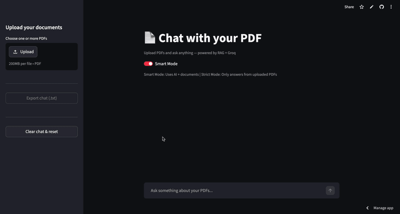

# 🧠 DocuMind AI — Intelligent Multi-Document RAG Assistant

<p align="center">
  
</p>

An enterprise-grade Retrieval-Augmented Generation (RAG) conversational assistant that enables deep, contextual Q&A across multiple documents (`.pdf`, `.txt`, `.md`). Built with a high-precision two-stage retrieval pipeline combining **Maximal Marginal Relevance (MMR)** and a **BGE Cross-Encoder reranker**, powered by **LLaMA 3.3 70B** via Groq for sub-second streaming answers.

[](https://python.org)
[](https://streamlit.io)
[](https://langchain.com)
[](https://groq.com)
[](LICENSE)

---

## 👨‍💻 Author & Connect

* **Developer:** Anurag Gurjar
* **LinkedIn:** [linkedin.com/in/anuraggurjar1](https://www.linkedin.com/in/anuraggurjar1/)
* **GitHub:** [@anuraggurjar01](https://github.com/anuraggurjar01)

---

## ✨ Key Features

- **Multi-Document & Multi-Format Ingestion** — Upload and index `.pdf`, `.txt`, and `.md` files concurrently.
- **Two-Stage Retrieval Pipeline** — 
  1. Dense vector search with **MMR (Maximal Marginal Relevance)** on `all-MiniLM-L6-v2` embeddings in ChromaDB to retrieve 20 diverse chunk candidates.
  2. Deep cross-attention reranking using **BAAI/bge-reranker-base** to filter down to the top-scoring chunks.
- **Dual Operating Modes**:
  - **Smart Mode**: Synthesizes uploaded document context with general reasoning when additional context is helpful.
  - **Strict Mode**: Restricts generation strictly to retrieved document chunks with zero external extrapolation.
- **Query Intent Classifier** — Automatically detects query patterns (`compare`, `summarize`, `definition`, `explain`, `general`) and dynamically enforces structured formatting.
- **Performance & Relevance Observability** — Real-time latency tracking (`⚡ Generated in Xs`) and page-level source citations with cross-encoder relevance scores.
- **Configurable LLM Inference** — Switch between Groq models (`LLaMA 3.3 70B`, `LLaMA 3.1 8B`, `Mixtral 8x7B`) and tune temperature and retrieval depth on the fly.
- **Session Export** — Export conversation logs with complete attribution in clean `.txt` format.

---

## 🏗️ Architecture & Pipeline Flow

```
                      User Query
                          │
            ┌─────────────┴─────────────┐
            ▼                           ▼
    Query Intent Classifier     Chat History Contextualizer
    (compare/summarize/etc.)    (Rewrite into standalone query)
            │                           │
            └─────────────┬─────────────┘
                          │
                          ▼
            ChromaDB Vector Store (all-MiniLM-L6-v2)
                 [MMR: fetch 40 ➔ return 20]
                          │
                          ▼
             BAAI/bge-reranker-base Cross-Encoder
                 [Reranks 20 ➔ Top 5 Chunks]
                          │
                          ▼
             Groq API (LLaMA 3.3 70B Versatile)
                 [Prompt Template + Format Rules]
                          │
                          ▼
             Token-by-Token Streaming Response 
                 + Source Citations & Scores
```

---

## 📁 Repository Structure

```
documind-ai/
├── app.py              # Streamlit frontend & interactive chat interface
├── rag_chain.py        # 2-stage retrieval pipeline, reranker & Groq LLM chain
├── ingest.py           # Multi-format document ingestion, chunking & ChromaDB indexing
├── requirements.txt    # Python dependencies
├── runtime.txt         # Deployment runtime configuration
├── LICENSE             # MIT License
├── .env                # Environment variables (API keys - not committed)
├── .gitignore
└── README.md
```

---

## 🚀 Quickstart Guide

### 1. Clone the Repository

```bash
git clone https://github.com/anuraggurjar01/documind-ai.git
cd rag-chatbot
```

### 2. Set Up a Virtual Environment

```bash
# Windows
python -m venv venv
venv\Scripts\activate

# macOS / Linux
python3 -m venv venv
source venv/bin/activate
```

### 3. Install Dependencies

```bash
pip install -r requirements.txt
```

### 4. Configure Environment Variables

Create a `.env` file in the root directory:

```env
GROQ_API_KEY=your_groq_api_key_here
```

> **Note:** Get a free Groq API key in under 30 seconds at [console.groq.com](https://console.groq.com).

### 5. Launch the Application

```bash
streamlit run app.py
```

The web interface will open automatically at `http://localhost:8501`.

---

## ⚙️ Configuration Reference

| Parameter | Default | Description |
|---|---|---|
| **Embedding Model** | `all-MiniLM-L6-v2` | SentenceTransformer embedding model (384 dimensions) |
| **Reranker Model** | `BAAI/bge-reranker-base` | Cross-encoder for relevance scoring |
| **Primary LLM** | `llama-3.3-70b-versatile` | Ultra-fast inference via Groq Cloud |
| **Chunk Size** | `800` tokens | Text chunk length via `RecursiveCharacterTextSplitter` |
| **Chunk Overlap** | `150` tokens | Preserves continuity across segment boundaries |
| **MMR Candidates (`fetch_k`)** | `40` | Initial candidate pool fetched from vector store |
| **MMR Diverse Pool (`k`)** | `20` | Filtered candidates passed to the reranker |
| **Final Reranked Chunks (`top_k`)** | `5` | High-confidence chunks injected into LLM prompt |

---

## 🌐 Free Cloud Deployment (Streamlit Community Cloud)

1. Push your repository to your GitHub account:
   ```bash
   git init
   git add .
   git commit -m "Initial commit: DocuMind AI by Anurag Gurjar"
   git branch -M main
   git remote add origin https://github.com/anuraggurjar01/documind-ai.git
   git push -u origin main
   ```
2. Navigate to [share.streamlit.io](https://share.streamlit.io).
3. Connect your GitHub repository and select `app.py` as the entry point.
4. Under **Advanced Settings > Secrets**, configure:
   ```toml
   GROQ_API_KEY = "your_groq_api_key"
   ```
5. Click **Deploy** to receive your permanent live URL!

---

## 📄 License

This project is licensed under the MIT License — see the [LICENSE](LICENSE) file for details.
